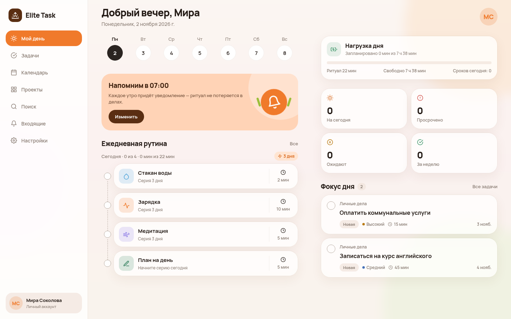
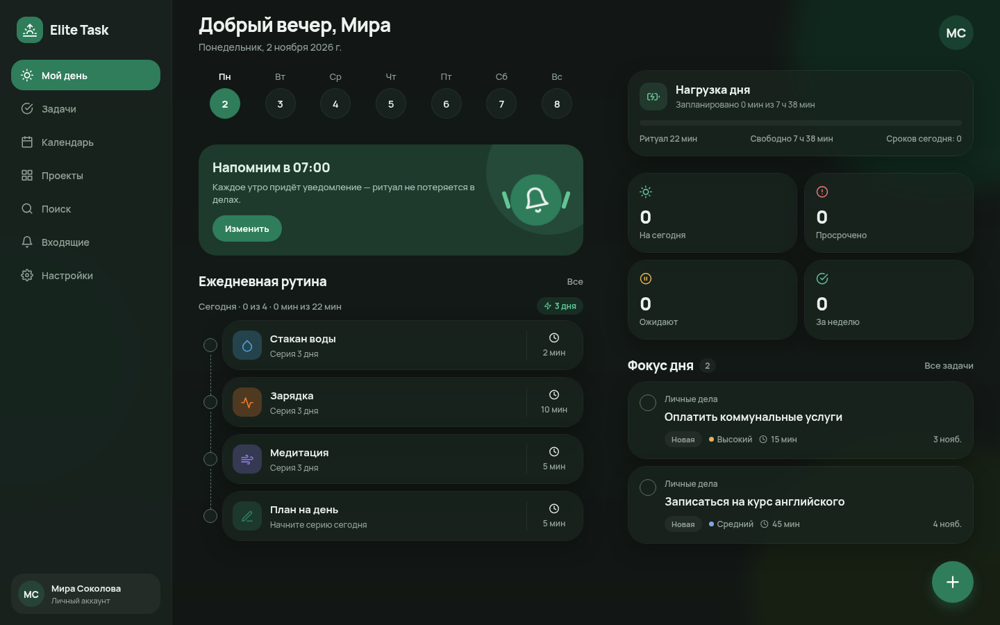
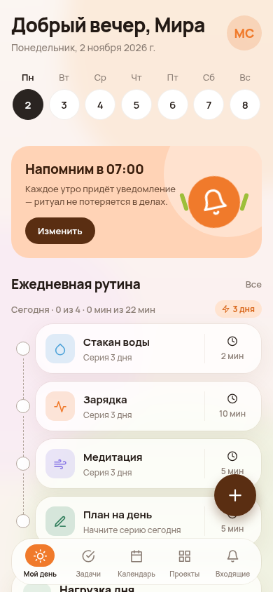
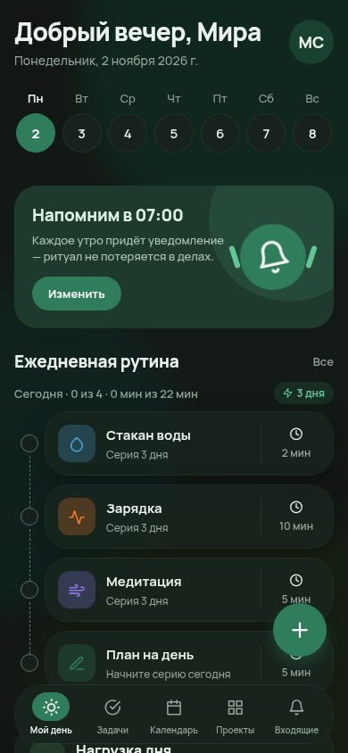
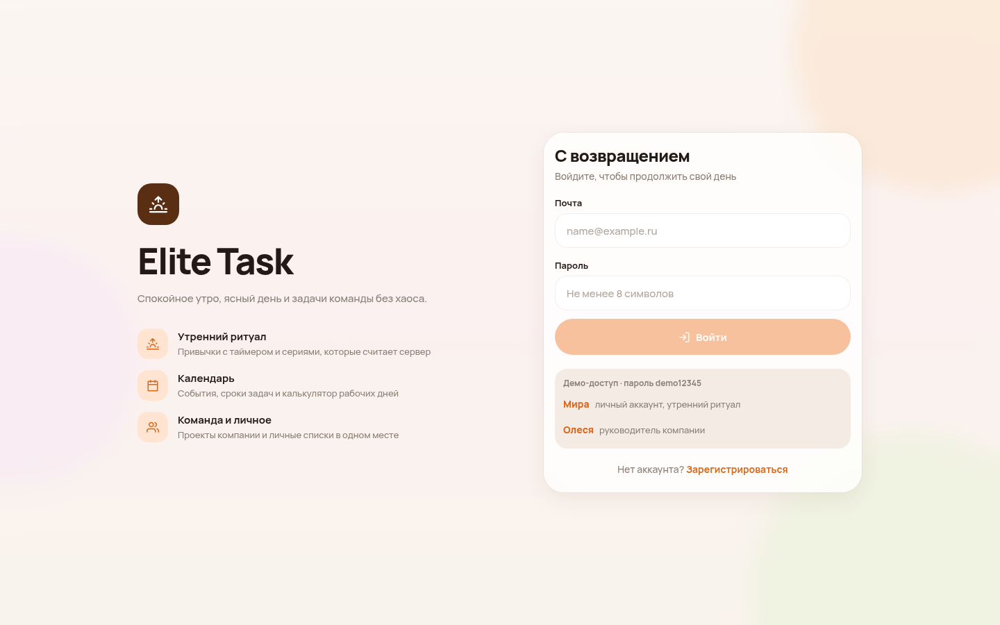
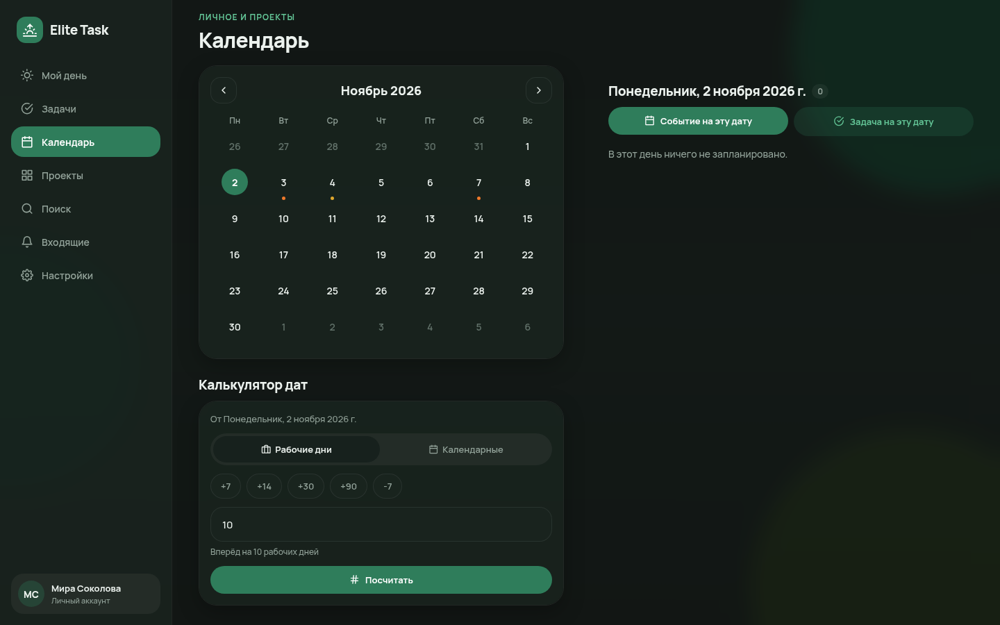

# Elite Task

Таск-менеджер с утренним ритуалом: личные привычки, задачи компании и календарь в одном приложении.
Бэкенд — FastAPI + SQLAlchemy (async), клиент — Expo (iOS, Android и сайт через Expo Web).

## Возможности

**Утренний ритуал («Мой день»)**
- приветствие по времени суток, лента дней недели (Пн–Вс), отметки за прошлые дни (до 7 дней назад);
- ежедневные привычки с иконкой, цветом и длительностью; серии (streak) считает сервер в часовом поясе пользователя;
- таймер привычки, по окончании — автоматическая отметка;
- ежедневное напоминание через `expo-notifications` (на телефоне);
- «Нагрузка дня»: рабочий день минус ритуал минус оценки задач на сегодня, предупреждение о перегрузе;
- фокус-задачи и счётчики: сегодня, просрочено, ожидают, сделано за неделю.

**Задачи**
- фильтры «Все / Сегодня / Неделя / Просрочено / Избранное / Завершённые»;
- карточка задачи: статус (для «Ожидание» нужна причина), чек-лист (добавление, отметка, удаление), подзадачи, файлы, заметки, комментарии, история;
- оценка времени, избранное, соисполнители.

**Календарь**
- сетка месяца с метками дней, повестка выбранного дня (сроки задач и события);
- личные события и события своих проектов, «Создать событие / задачу на эту дату»;
- калькулятор дат: ±N календарных или рабочих дней.

**Проекты и роли**
- личные проекты — может создать любой, управляет только владелец, приглашение по email;
- проекты компании создают только руководитель и администратор;
- роли: `leader`, `admin`, `manager` (сотрудники компании) и `personal` (личный аккаунт, открытая регистрация).
- Подробнее о правах — в [`docs/ROLES.md`](docs/ROLES.md).

**Интерфейс**
- светлая тема (акцент `#F07A2B`) и тёмная тема (акцент `#2F7D5B`), переключатель «Светлая / Тёмная / Системная»;
- полупрозрачные карточки с blur и мягким градиентным фоном, шрифт Manrope;
- адаптивная вёрстка: на телефоне нижняя панель, на широком экране (от 900 px) боковое меню и две колонки;
- уведомления в реальном времени по WebSocket (одноразовый билет вместо JWT в URL).

**Безопасность**
- все проверки прав выполняются на сервере, клиент только прячет недоступные кнопки;
- ограничение перебора паролей, выход со всех устройств (версия токена), смена пароля;
- в production приложение не запускается со слабым `JWT_SECRET`, `CORS_ORIGINS=*` или демо-данными.

## Быстрый старт

### 1. API

```bash
cd apps/api
python -m venv .venv
# Windows: .\.venv\Scripts\activate    macOS/Linux: source .venv/bin/activate
pip install -r requirements-dev.txt
cp .env.example .env          # Windows: Copy-Item .env.example .env
uvicorn app.main:app --reload --host 0.0.0.0 --port 8000
```

Swagger: `http://localhost:8000/docs`. Все переменные окружения описаны в `apps/api/.env.example`.

### 2. Мобильное приложение

```bash
cd apps/mobile
npm install
cp .env.example .env
npm run start          # если Metro падает на Node 24 — npm run start:lts
```

- Android/iOS: Expo Go → QR-код из терминала (Android-эмулятор — клавиша `a`).
- Android-эмулятор: `EXPO_PUBLIC_API_URL=http://10.0.2.2:8000`.
- Физический телефон: IP компьютера в локальной сети, например `http://192.168.1.20:8000`.
- Напоминания работают только в нативной сборке. Веб-версия честно показывает, что они недоступны.

### 3. Сайт (Expo Web)

Режим разработки: `npm run web` → `http://localhost:8081`.

Статическая сборка:

```bash
cd apps/mobile
EXPO_PUBLIC_API_URL=https://api.example.com npm run export:web   # результат в apps/mobile/dist
npm run serve:web                                                # локальная проверка на :8081
```

Папку `dist` можно выложить на любой статический хостинг. Домен сайта нужно добавить в `CORS_ORIGINS` API.

## Демо-пользователи

Пароль у всех: `demo12345`.

| Email | Роль |
|---|---|
| `mira@elite-task.ru` | личный аккаунт (`personal`), утренний ритуал и личные проекты |
| `leader@elite-task.ru` | руководитель |
| `admin@elite-task.ru` | администратор |
| `olesya@elite-task.ru` | менеджер |
| `maya@elite-task.ru` | менеджер |

## Проверки

```bash
cd apps/api
python -m pytest -q
ruff check app tests --select F,E9,I

cd ../mobile
npm run typecheck
```

## Документация

- [`docs/ROLES.md`](docs/ROLES.md) — роли и права доступа;
- [`docs/API.md`](docs/API.md) — эндпоинты API v2;
- [`docs/IMPLEMENTATION_PLAN.md`](docs/IMPLEMENTATION_PLAN.md) — план и этапы.
- [`docs/MANAGER_DEMO_GUIDE.md`](docs/MANAGER_DEMO_GUIDE.md) — сценарий показа и правила подготовки скриншотов;
- [`docs/TEST_REPORT_2026-11-03.md`](docs/TEST_REPORT_2026-11-03.md) — результаты полного локального тестирования v2;
- [`deliverables/Elite_Task_для_менеджеров_v2.pptx`](deliverables/Elite_Task_для_менеджеров_v2.pptx) — презентация для менеджеров.

## Скриншоты

| Светлая тема | Тёмная тема |
|---|---|
|  |  |
|  |  |
|  |  |
